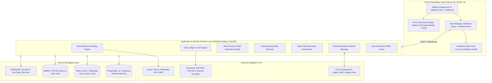
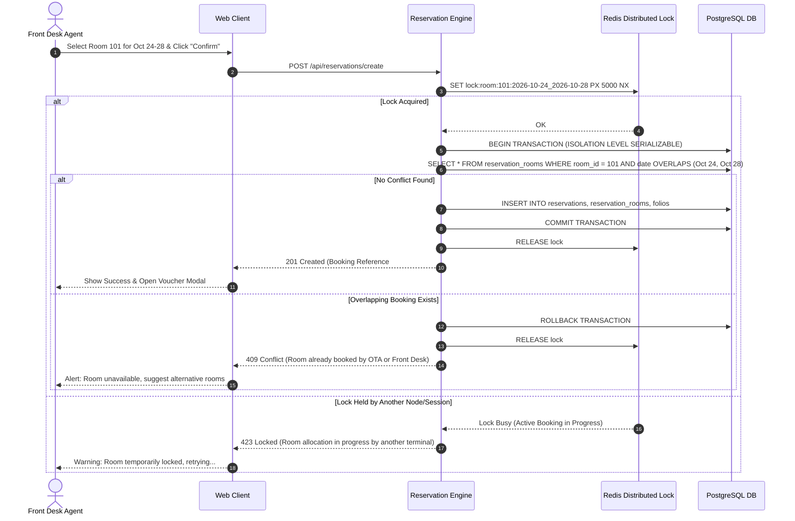
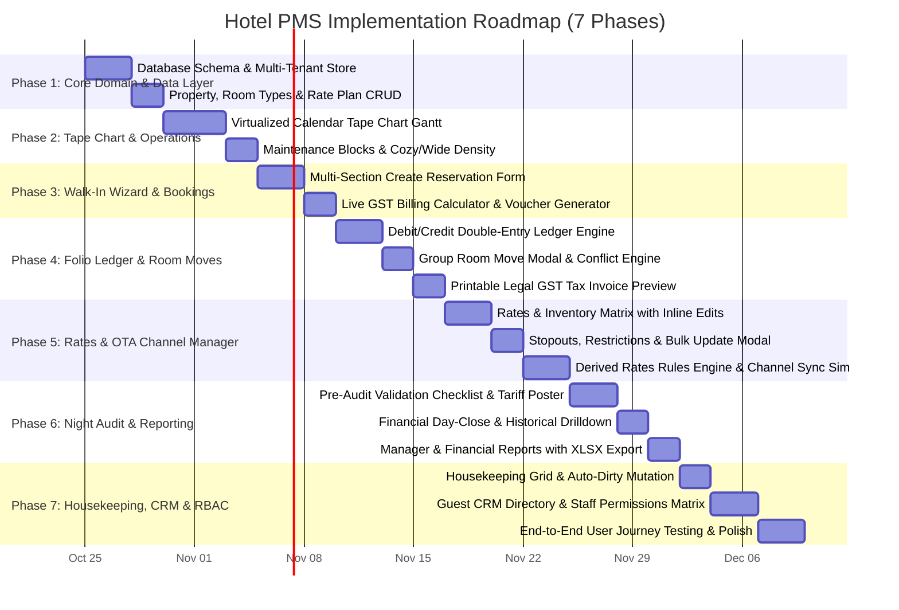

# Phased Engineering Milestone Plan & Technical Architecture Specification: Hotel PMS

---

## 1. Executive Technical Architecture Specification

### 1.1 Architectural Topology Overview



---

### 1.2 Core Domain Subsystems & Boundaries

| Subsystem | Responsibilities | Key Dependencies & Concurrency Strategy |
| :--- | :--- | :--- |
| **Reservations & Allocation** | Walk-in wizard, stay duration, multi-room rate allocation, group room moves, status transitions. | Distributed Redis lock on `(room_id, date)` during allocation; Pessimistic row locking on checkout. |
| **Tape Chart Engine** | High-density visual Gantt matrix of rooms vs dates, drag-to-select, Cozy/Wide density, maintenance locks. | Virtualized DOM rows; O(1) cell allocation indexing via compound hash `date_roomId`. |
| **Folio & Financial Ledger** | Double-entry debit/credit transactions, multi-payment reconciliation, Indian GST/SAC tax engine, legal invoice formatting. | Immutable ledger pattern; transactions are appended with audit metadata. Balances computed via materialized aggregations. |
| **Rates & Inventory (ARI)** | Daily base rates, extra adult/child rates, Stop-sell toggles, Min/Max length of stay, Closed-to-Arrival/Departure. | Bulk transactional updates with date-range batching; change-data-capture triggers for OTA sync. |
| **Channel Manager & Derivation** | Rate formula transformation ($\text{OTA} = \text{Base} \times (1 - \text{Discount}) + \text{Markup}$), room/plan mapping, outbound ARI push. | BullMQ background workers with exponential backoff retry; deduplication of rapid successive rate updates. |
| **Night Audit Orchestrator** | Pre-audit checklist verification, midnight room charge posting + GST slab computation, operational date rollover. | Serialized single-execution lock per property; transactional batch posting with rollback safety. |
| **Housekeeping & Rooms** | Clean, Dirty, Maintenance, Inspected state tracking, auto-dirty trigger upon checkout, room move conflict checks. | Event-driven status mutations emitted on reservation lifecycle events. |
| **Granular RBAC & Multi-Tenancy** | Property scoping, role assignments (Owner, GM, Front Desk, Housekeeper, Auditor), feature-level permission toggles. | PostgreSQL Row-Level Security (RLS) enforcement with `property_id` claims injected into execution contexts. |

---

### 1.3 Concurrency Control & Double-Booking Prevention



---

### 1.4 Regional Tax Compliance Engine (Indian GST & HSN/SAC)

The billing and night audit modules adhere strictly to Indian Hotel GST rules:

$$\text{GST Rate} = \begin{cases} 
12\% \ (\text{CGST } 6\% + \text{SGST } 6\%), & \text{if Effective Daily Room Tariff} < \text{₹}7,500 \\
18\% \ (\text{CGST } 9\% + \text{SGST } 9\%), & \text{if Effective Daily Room Tariff} \ge \text{₹}7,500 
\end{cases}$$

- **HSN/SAC Code Mapping:**
  - `996311`: Room accommodation services provided by hotels, inns, guest houses.
  - `996331`: Food and beverage services (5% without ITC or 18% with ITC).
- **Tax Breakdown in Invoices:** Explicit splitting of Taxable Base Amount, CGST, SGST, and Total Invoice Amount with hotel GSTIN and Guest GSTIN (for B2B corporate credit pass-through).

---

## 2. Phased Engineering Milestone Roadmap



---

### Detailed Milestone Breakdown

#### Milestone 1: Foundation, Multi-Tenant Domain & Configuration
- **Objective:** Establish the foundational architecture, relational data models, and property setup wizards.
- **Deliverables:**
  1. Multi-tenant database migrations for `properties`, `room_types`, `rooms`, `meal_plans`, `rate_plans`, `guests`, `reservations`, `folios`, `night_audits`, and `audit_trails`.
  2. Property Onboarding Wizard (`/properties/create`) capturing GSTIN, legal names, timezones, and operational check-in/out times.
  3. Meal Plan CRUD (`/properties/meal-plans`) with EP/CP/MAP/APAI meal schedules and inclusions.
  4. Room Type & Physical Room CRUD (`/properties/rooms`) with batch room number generation.
- **Verification Criteria:**
  - Ability to create a property with 3 room types and 15 physical rooms.
  - Meal plans correctly associate with rate plans.

#### Milestone 2: Calendar Tape Chart (Gantt Matrix) Engine
- **Objective:** High-performance, interactive timeline for front-desk dispatch.
- **Deliverables:**
  1. Horizontal Gantt view rendering rooms on Y-axis and rolling dates on X-axis.
  2. Cozy vs Wide density toggle for room rows.
  3. Real-time occupancy percentage calculations for each day header.
  4. Cell click-to-book and drag-to-select range selection.
  5. Maintenance Block modal with reason capture (AC Repair, Painting, Water Leak) rendering orange locked blocks.
- **Verification Criteria:**
  - Sub-100ms render performance across 30 days and 25+ rooms.
  - Booking blocks span correctly across start and end dates with status color codes.

#### Milestone 3: Walk-In Wizard, Real-Time Billing & Voucher Generation
- **Objective:** Rapid front-desk reservation capture under 60 seconds.
- **Deliverables:**
  1. Multi-step/accordion reservation creator (`/reservations/create`).
  2. Dynamic stay calculation (Nights count badge) and market segment attribution.
  3. Multi-room builder: add multiple rooms of different types in a single master booking.
  4. Live sticky billing summary with automatic Indian GST slab calculation (12% vs 18%).
  5. Advance payment collection (Cash, UPI, Card) with reference ID.
  6. Branded printable Booking Voucher modal with print styling and email dispatch trigger.
- **Verification Criteria:**
  - Adding multiple rooms recalculates tax and totals instantly.
  - Balance due reflects advance payment deduction upon save.

#### Milestone 4: Folio Ledger, Room Move & Legal GST Invoice Engine
- **Objective:** Complete financial tracking, guest ledger balancing, and room reallocations.
- **Deliverables:**
  1. Folio Operations Drawer (`/reservations/edit/[id]`) with double-entry debit/credit ledger.
  2. Inline Room Charges table auditing daily tariffs.
  3. Group Room Move Modal with dirty-room detection and automatic tape-chart re-rendering.
  4. Folio Settlement Modal (zero-balance validation before checkout).
  5. Legal GST Tax Invoice Preview Modal with SAC codes, CGST/SGST split, and print trigger.
- **Verification Criteria:**
  - Checking out a reservation automatically sets the assigned room to `DIRTY` in the housekeeping subsystem.
  - Invoices display accurate GST breakdown matching government formats.

#### Milestone 5: Rates, Stop-Sells, Bulk Restrictions & OTA Channel Manager
- **Objective:** Comprehensive revenue management and channel rate distribution.
- **Deliverables:**
  1. Rates & Inventory Grid (`/rates-and-inventory`) supporting subtabs: *All Rates*, *Min Nights*, *Max Nights*, *Stopouts*, *CTA*, *CTD*.
  2. Inline cell editing for base rates, extra adult, and extra child rates.
  3. Interactive Stopouts: click-to-toggle stop-sell prohibition badge.
  4. Bulk Update Modal: multi-select room types, rate plans, date range, day-of-week pills (Mon-Sun), and rate/restriction values.
  5. OTA Channel Manager (`/rates-and-inventory/channels`): connected OTAs (Agoda, Booking.com, MMT, Google Hotel) with inventory mapping and derived rate formulas ($\text{Rate} = \text{Base} \times (1 - \text{Discount}) + \text{Markup}$).
- **Verification Criteria:**
  - Bulk updates correctly update all matching dates in the inventory matrix.
  - Channel sync queue demonstrates simulated ARI payload push with derived prices.

#### Milestone 6: Night Audit Day-Close & Financial Reporting
- **Objective:** Automated end-of-day revenue reconciliation and operational auditing.
- **Deliverables:**
  1. Night Audit View (`/night-audit`) with automated pre-audit checklist validation (Pending arrivals, departures, unsettled folios).
  2. Single-click Day Close routine: automatically posts daily room tariffs and GST debits to active in-house folios and rolls forward the business date.
  3. Night Audit Detail Drilldown modal displaying Room Charges breakdown, Checked-out log, and Pax overview.
  4. Financial & Operations Reports (`/reports`): Manager Report, Guest Details, Folio List, Night Audit summary with `.xlsx` export.
- **Verification Criteria:**
  - Day close successfully advances system business date and posts room charges.
  - Exported Excel spreadsheet contains accurate revenue and ledger reconciliations.

#### Milestone 7: Housekeeping Room Grid, Guest CRM, Granular RBAC & Hardening
- **Objective:** Complete operational hygiene tracking, customer relationships, and security controls.
- **Deliverables:**
  1. Housekeeping Room View (`/room-view`): color-coded status cards (Available, Occupied, Maintenance, Dirty) with quick status changer (e.g., Dirty -> Clean).
  2. Guest CRM Directory (`/guests`) showing historical stay counts, total spent, and contact attributes.
  3. Granular RBAC Permission Matrix (`/permissions`) with category-level toggles (Reservations, Night Audit, Rates & Inventory, Team, Dashboard, PII Access, Ledger).
  4. Audit Trail Timeline tab showing chronological system mutations with actor attribution.
- **Verification Criteria:**
  - Front desk is blocked from assigning a `DIRTY` room to a new reservation.
  - Staff permissions restrict unauthorized users from accessing Night Audit and Ledger operations.

---

## 3. Technology Stack & Directory Architecture

```
d:/new full hotel/
├── docs/
│   ├── PRD.md
│   └── ARCHITECTURE.md
├── src/
│   ├── assets/
│   ├── components/
│   │   ├── common/             # Button, Modal, Input, Badge, Toast, Dropdown
│   │   ├── layout/             # Sidebar, TopNav, PropertySwitcher, Shell
│   │   ├── calendar/           # TapeChartView, MaintenanceModal, QuickBookModal
│   │   ├── reservations/       # ReservationsView, CreateReservationWizard, VoucherModal
│   │   ├── folios/             # FolioModal, InvoiceModal, AddTransactionModal
│   │   ├── housekeeping/       # RoomStatusGrid, RoomCard, HygieneFilter
│   │   ├── rates/              # RatesMatrixView, BulkUpdateModal, ChannelManager
│   │   ├── nightaudit/         # NightAuditView, AuditChecklist, AuditDetailModal
│   │   ├── reports/            # ReportsView, ExcelExportButton, SummaryCards
│   │   ├── guests/             # GuestDirectoryView, GuestDetailDrawer
│   │   ├── settings/           # PropertyWizard, MealPlansView, RoomConfigView
│   │   └── permissions/        # TeamView, RBACMatrixView, InviteMemberModal
│   ├── services/
│   │   ├── pmsStore.js         # Reactive Local & Cloud Sync Store (ACID emulation)
│   │   ├── taxEngine.js        # Indian GST & SAC code calculator
│   │   ├── auditEngine.js      # Night audit tariff poster & date incrementer
│   │   ├── channelSync.js      # Derived rate calculator & ARI push queue
│   │   └── exportService.js    # XLSX & PDF generator utilities
│   ├── hooks/
│   │   ├── useTapeChart.js     # Virtualized calendar timeline coordinator
│   │   └── usePermissions.js  # RBAC access controller
│   ├── data/
│   │   └── initialPmsData.js   # Production-fidelity seed data (Royale Avenue BnB)
│   ├── App.jsx
│   ├── main.jsx
│   └── index.css               # Premium design system tokens & styles
├── package.json
└── vite.config.js
```
